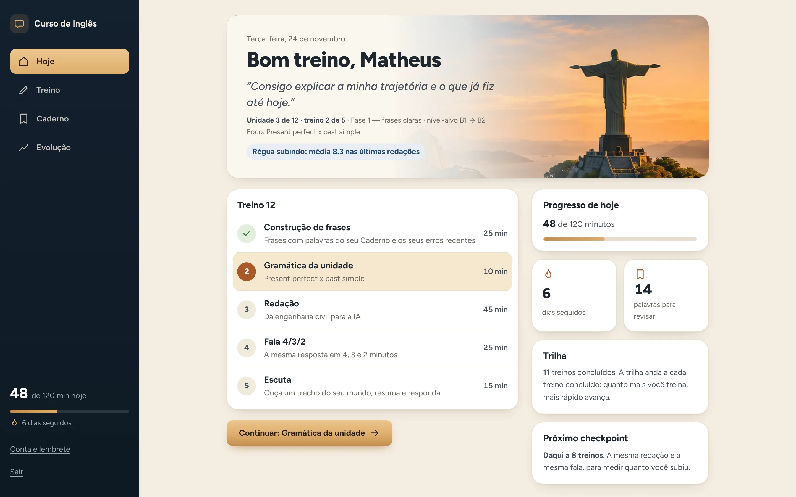
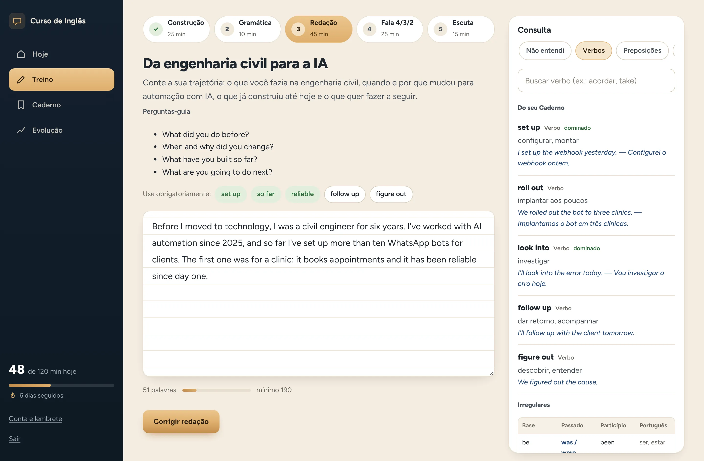
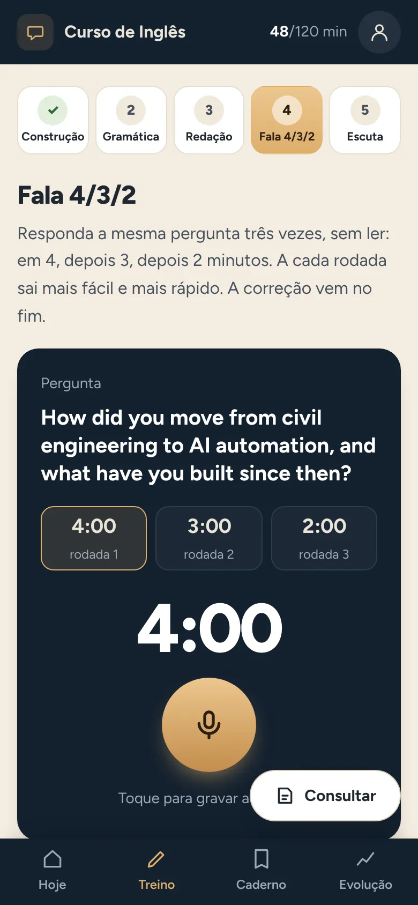
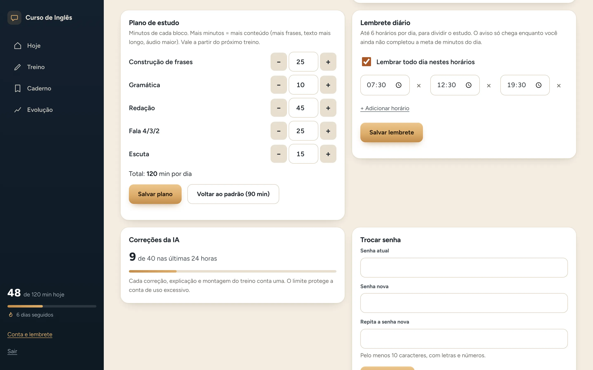
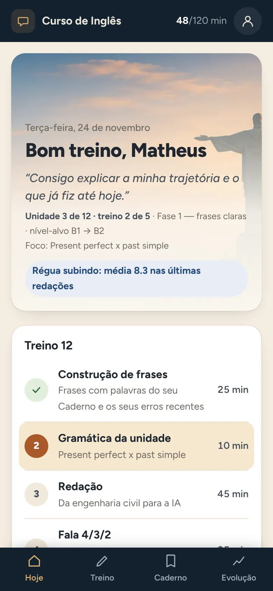
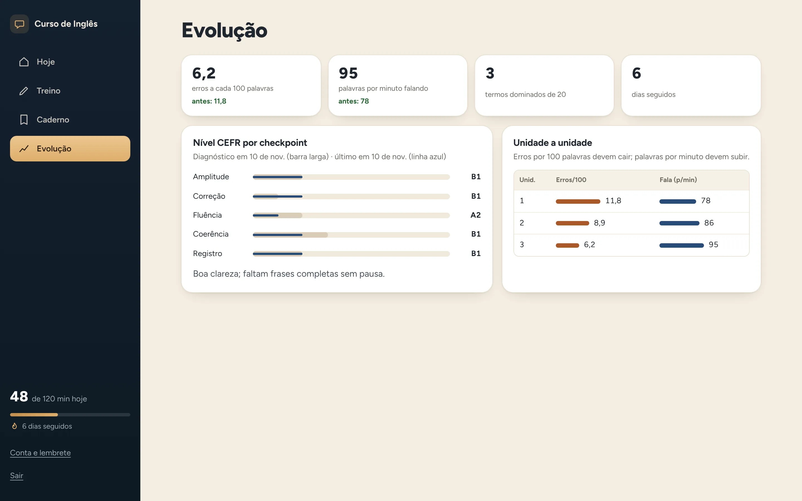
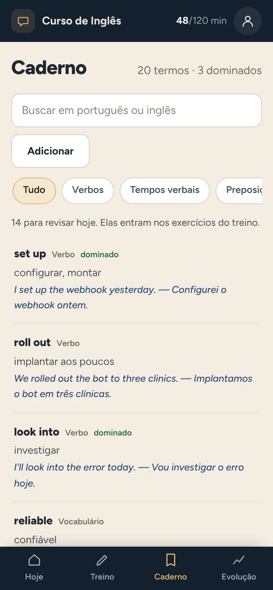
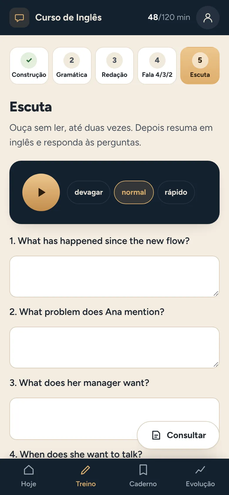
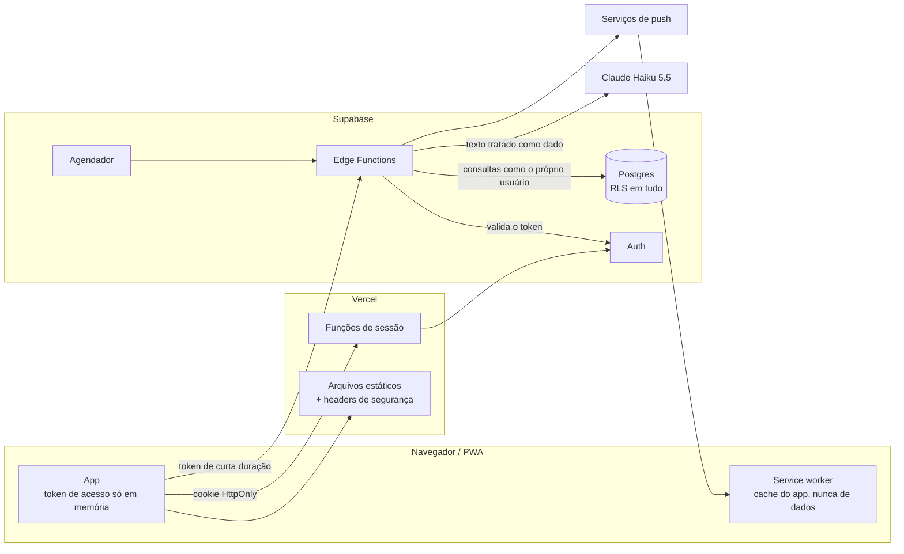

# Curso de Inglês

**Treino diário de inglês por produção (escrever e falar) com correção por IA, trilha CEFR e evolução medida.**
Feito para destravar o inglês de trabalho de duas pessoas reais (eu e a minha esposa, Helena), com segurança de produto de verdade.

[**ingles.mpstudio.ia.br**](https://ingles.mpstudio.ia.br) · PWA instalável · funciona offline para escrever e consultar

> **In English —** A personal English-training platform for two professionals — me (an AI automation engineer at B1) and my wife Helena (a corporate lawyer at C1). Every exercise forces *production* — writing and speaking about their real work — and is corrected by Claude through a Supabase Edge Function that runs every query **as the signed-in user under Row Level Security** (no service-role key anywhere). Sessions use an HttpOnly cookie BFF on Vercel, the app is an installable offline-capable PWA, and the learning plan follows CEFR can-do descriptors, the 4/3/2 fluency technique and spaced repetition. It also has a listening block, daily push reminders and an offline queue that sends work for correction when the signal returns. Covered by automated end-to-end and API tests plus a self-test against the real model. The source code lives in a private repository; this one is a showcase.

---

## Sumário

- [Por que existe](#por-que-existe)
- [O que ele faz](#o-que-ele-faz)
- [Como o aprendizado funciona](#como-o-aprendizado-funciona)
- [Arquitetura](#arquitetura)
- [Stack](#stack)
- [Segurança](#segurança)
- [App no celular e modo offline](#app-no-celular-e-modo-offline)
- [Testes](#testes)
- [Decisões de projeto](#decisões-de-projeto)
- [Como foi construído](#como-foi-construído)
- [Próximos passos](#próximos-passos)

---

## Por que existe

Eu trabalho com automação e IA (bots de WhatsApp, n8n, Supabase, LLMs), e o inglês era o que mais travava as minhas candidaturas para **Forward Deployed Engineer / AI Engineer**, então construí a ferramenta que eu precisava. Eu entendo o que leio, mas travo na hora de **produzir**: escrever uma mensagem para cliente, explicar um fluxo, falar de um projeto numa entrevista.

Apps genéricos não resolviam isso: treinam reconhecimento (múltipla escolha, ouvir e repetir) com temas que não são do meu mundo. Eu precisava de um treino que:

- me fizesse **escrever e falar todos os dias**, no tempo que eu escolher (1h30, 2h...), com dificuldade crescente;
- usasse o **meu trabalho** como tema (descoberta com cliente, explicar uma automação, relatar um incidente, TryHackMe);
- corrigisse na hora, explicasse o erro e **reciclasse os meus próprios erros** nos exercícios seguintes;
- **medisse a evolução** de forma honesta, sempre com a mesma régua.

O mesmo app atende a minha esposa, Helena, com outro objetivo: ela é advogada de jurídico corporativo, já em nível avançado, que conduz reuniões em inglês. A trilha dela é jurídica e corporativa (conduzir reunião, discordar com diplomacia, negociar cláusula, explicar risco para a diretoria). **Mesma plataforma, duas trilhas, dados totalmente isolados.**

## O que ele faz

| | |
|---|---|
| **Treino em 5 blocos, com tempo ajustável** | Padrão de 90 min: Construção de frases (15) · Gramática da unidade (15) · Redação (35) · Fala 4/3/2 (15) · Escuta (10). Em **Conta → Plano de estudo** cada bloco ganha ou perde minutos (total de 30 min a 4 h); a quantidade de exercícios, o tamanho da redação e o da escuta acompanham. |
| **Progressão por treino concluído** | A trilha anda por treino, não pelo calendário: cada unidade tem 5 treinos e não há limite por dia. Quem faz uma semana em dois dias avança na mesma velocidade. Ao concluir um treino o próximo já começa a ser montado. |
| **Régua adaptativa** | A média das últimas 5 redações sobe a exigência (≥ 8: mais palavras e mais termos obrigatórios, menos dicas) ou consolida (< 5,5). |
| **Construção de frases** | 8 frases (no tempo padrão) para traduzir/transformar, com palavras do Caderno que estão vencendo e erros reais recentes. |
| **Gramática da unidade** | Explicação curta + 8 frases suas (no tempo padrão), das mais fáceis às mais longas. |
| **Redação** | Tema do dia do mundo da pessoa, palavras obrigatórias, contador de palavras e alertas de erros típicos de brasileiros enquanto digita. Correção completa: nota, versão corrigida, cada erro explicado, termos para guardar. |
| **Fala 4/3/2** | A mesma resposta 3 vezes em 4, 3 e 2 minutos, com cronômetro e transcrição no navegador. Correção no fim: versão natural, erros que atrapalham, palavras por minuto por rodada. |
| **Escuta** | Um áudio curto do mundo da pessoa (reunião, call, áudio de cliente), lido pelo navegador em velocidade normal ou lenta. A pessoa resume e responde 3 perguntas sem ler o texto; a correção mostra o que escapou e libera a transcrição. |
| **Consulta** | "Não entendi" (explica qualquer frase), verbos irregulares, preposições, phrasal verbs, expressões, vocabulário, pronúncia, meus erros. |
| **Caderno** | 286 termos migrados do Notion, revisão espaçada (1, 3, 7, 15, 30, 60 dias), "dominado" após 4 acertos. |
| **Evolução** | Nível CEFR por checkpoint (5 aspectos), erros a cada 100 palavras, palavras por minuto, termos dominados, dias seguidos. |
| **Login e conta** | E-mail e senha, "lembrar de mim", mostrar senha, recuperação por e-mail. Na tela Conta: foto de perfil (até 5 MB), instalar o app, ativar as notificações neste aparelho, trocar a senha (pede a atual), plano de estudo (minutos por bloco), lembretes (vários horários) e quanto da cota de IA já foi usada hoje. |
| **Lembretes** | Até 6 horários por dia, para dividir o estudo. Cada horário avisa uma vez, só enquanto a meta de minutos do dia (a soma do plano de estudo) não foi cumprida. |
| **Caderno = material de consulta** | Toda correção (exercícios, redação, fala, escuta, dúvidas) grava sozinha os erros em "Meus erros" e os termos novos no Caderno, sem duplicar. O Caderno traz também vocabulário, verbos, expressões, preposições e tempos verbais de referência, e tudo isso (menos os erros) vira exercício na trilha. |

<table>
<tr>
<td width="62%"></td>
<td width="38%"></td>
</tr>
<tr>
<td></td>
<td></td>
</tr>
<tr>
<td></td>
<td></td>
</tr>
<tr>
<td></td>
<td></td>
</tr>
</table>

Capturas com dados de exemplo.

## Como o aprendizado funciona

O planejamento não é uma lista solta de exercícios. Ele se apoia em referências de ensino de línguas:

| Referência | Como entra no app |
|---|---|
| **CEFR** (Council of Europe, *Companion Volume*, 2020) | Cada unidade tem um objetivo "Consigo…" no nível-alvo (B1 → B2 na trilha técnica; C1 → C1+/C2 na jurídica). A avaliação dos checkpoints usa os aspectos qualitativos do CEFR: amplitude, correção, fluência, coerência e registro. |
| **As quatro vertentes de Paul Nation** | O dia equilibra foco na forma (construção e gramática), produção com foco no sentido (redação), desenvolvimento de fluência (fala) e insumo (versões corrigidas e naturais para ler em voz alta). |
| **Técnica 4/3/2 + correção posterior** (Tran & Saito, 2021) | Repetir a mesma fala com menos tempo aumenta a fluência; a correção depois da fala cuida da precisão, que a pressão de tempo sozinha não melhora. |
| **Revisão espaçada** (Cepeda et al., 2008) | O Caderno volta nos exercícios em intervalos crescentes; errou, volta amanhã. |

**Trilha de 12 unidades, renovável.** Cada unidade tem 5 treinos. Fase 1 (frases claras) → Fase 2 (parágrafos ligados) → Fase 3 (explicar e convencer). O mínimo de palavras e as palavras obrigatórias sobem por fase. Depois da unidade 12 começa um novo ciclo, mais exigente.

**Diagnóstico e checkpoints.** O primeiro treino é um diagnóstico. No último treino das unidades 4, 8 e 12 a pessoa repete **a mesma redação e a mesma fala** e recebe a rubrica CEFR, o que permite comparar o antes e o depois com a mesma régua.

**O plano se adapta.** A IA monta o treino do dia com: palavras do Caderno que estão vencendo, os pontos fracos medidos nas últimas duas semanas, os aspectos mais fracos do último checkpoint e os erros reais dos últimos 7 dias (reescritos em frases novas).

## Arquitetura

- **Front** sem framework, leve e instalável. O navegador nunca fala direto com as tabelas.
- **Sessão no servidor**: funções pequenas na Vercel trocam login e renovação com o Supabase Auth e guardam a sessão longa num cookie que o JavaScript não lê.
- **Edge Functions**: uma porta de entrada para o treino, que valida o usuário e roda cada consulta com a identidade dele, para que **o banco decida o que cada pessoa vê e grava**; e uma para os lembretes, chamada pelo agendador com um segredo guardado no cofre do Supabase e com um papel de banco que não lê tabela nenhuma.
- **Postgres** com RLS em todas as tabelas, políticas por operação e gatilhos que forçam o dono de cada linha.
- **IA** chamada só pelo servidor, com resposta em JSON validado por schema; o texto do usuário é tratado como dado, e a saída é validada e escapada antes de aparecer.

## Stack

| Camada | Tecnologia |
|---|---|
| Interface | HTML, CSS (tokens, grade de 4 px, Figtree), JavaScript ES modules, Vite 5 |
| App instalável | Web App Manifest, service worker, ícones maskable |
| Voz | Web Speech API (reconhecimento e leitura em en-US no navegador) |
| Notificações | Web Push (VAPID, `web-push`), `pg_cron` + `pg_net`, Supabase Vault |
| Sessão | Funções Node da Vercel, cookies HttpOnly |
| Backend | Supabase Edge Functions (Deno + TypeScript), `postgres.js` |
| Banco | Supabase Postgres, Row Level Security, triggers, migrações versionadas |
| Arquivos | Supabase Storage (bucket privado, RLS por pasta) para a foto de perfil |
| IA | Anthropic Messages API (Claude Haiku 5.5, structured outputs) |
| Hospedagem | Vercel (domínio próprio, HTTPS, headers de segurança) |
| Testes | Playwright (e2e em computador e celular), `node:test` (API), gitleaks |
| Design | [Impeccable](https://impeccable.style) (skill de design, Apache 2.0) para padronizar tipografia, proporção e componentes |

## Segurança

Avaliado contra a minha **Matriz de Segurança de Plataformas** (baseada em OWASP Top 10:2025, OWASP API Security 2023, OWASP LLM Top 10 2026 e LGPD). Os controles estão resumidos em [`SECURITY.md`](SECURITY.md); a avaliação detalhada e o código ficam fora deste repositório. Em linhas gerais:

- **Autorização pelo banco:** RLS em tudo e nenhuma chave de administrador no projeto.
- **Sessão:** cookie `HttpOnly`/`Secure`/`SameSite=Strict`, token de acesso curto só em memória, proteção contra CSRF, logout que revoga a sessão.
- **API e IA:** validação e limite de entradas, cotas por pessoa, CORS restrito, defesa contra prompt injection e XSS.
- **Navegador:** CSP estrita, HSTS, proteção contra iframe e build sem source maps.
- **Segredos:** só nos provedores (Supabase e Vercel), nunca no Git; varredura de segredos a cada push.

## App no celular e modo offline

É um **PWA**: no celular, abra o site e escolha "Adicionar à tela de início" (iPhone: Safari → Compartilhar; Android: Chrome → Instalar app). Ele abre em tela cheia, com ícone próprio, sem loja de apps.

**Na tela Conta → Este aparelho** há o botão **Baixar o app** (Android e computador, quando o navegador permite) ou as instruções do iPhone, e o botão **Ativar neste aparelho** para receber o lembrete. No iPhone a notificação só funciona com o app instalado na tela de início (iOS 16.4 ou mais novo).

**Offline (metrô, estrada, avião):** a cada carga o app guarda neste aparelho uma cópia do dia (Caderno, plano e progresso). Sem sinal, ele abre com essa cópia: dá para **escrever, consultar verbos e expressões e revisar o Caderno**. Ao tocar em corrigir sem sinal, o texto entra numa **fila** e é enviado sozinho quando a internet volta. A cópia não tem token nem senha e é apagada ao sair da conta.

## Testes

- **Testes de ponta a ponta** (Playwright) em computador e celular, com o backend simulado: login e recuperação de senha, nenhuma credencial no armazenamento do navegador, todas as telas sem erro no console, os 5 blocos do treino, plano de estudo, lembretes, foto de perfil, modo offline e fila de correção, app instalável.
- **Testes das funções de sessão**, sem rede.
- **Autoteste com a IA de verdade**: roda os prompts reais com dados de exemplo, valida o formato e mede o tempo, sem tocar em dados de ninguém.
- CI a cada push com os testes e a varredura de segredos.

## Decisões de projeto

- **RLS como a única fonte de autorização.** Em vez de uma chave de administrador com filtros no código, a função assume a identidade do usuário em cada transação. Um bug na função não consegue ler dados de outra pessoa, porque o banco recusa.
- **BFF só para a sessão.** Um backend completo seria exagero para duas pessoas, mas guardar o refresh token no `localStorage` deixaria a sessão longa exposta a qualquer XSS. Funções pequenas na Vercel resolvem isso com cookie HttpOnly.
- **Sem framework no front.** São cinco telas e um fluxo; JavaScript puro deixa o app com 59 KB, fácil de auditar e rápido no celular. O SDK do Supabase também saiu do front, porque a sessão passou para o servidor.
- **Uma ação por chamada, um único endpoint.** Fica mais fácil aplicar limite, validação e log no mesmo lugar.
- **A mesma tarefa nos checkpoints.** Nota sozinha engana, porque os temas ficam mais difíceis; repetir a mesma tarefa mede a evolução de verdade.
- **Lembrete sem chave de administrador.** O envio roda com um papel do banco que não lê tabela nenhuma, só chama funções com o mínimo necessário.
- **PWA em vez de app de loja.** Para duas pessoas, loja de apps traria custo anual e revisão a cada atualização sem ganho real.

## Como foi construído

Projeto pessoal construído por mim com **programação assistida por IA** (Claude). Eu defini o problema, o público, a pedagogia, a arquitetura de segurança e os critérios de aceite; a IA acelerou a implementação, e cada etapa passou pela minha revisão, pela Matriz de Segurança e pelos testes automatizados.

Etapas:

1. **Descoberta:** o problema real (inglês travando vagas), as duas personas e o formato (produção, não reconhecimento).
2. **Dados:** migração do meu caderno de inglês do Notion (286 termos) para o Supabase, com RLS desde o primeiro dia.
3. **Pedagogia:** pesquisa de referências (CEFR, Nation, 4/3/2, revisão espaçada) e desenho da trilha com checkpoints.
4. **Backend:** Edge Function com autorização pelo próprio banco, cotas de IA e prompts com defesa contra injeção.
5. **Design:** wireframes, iteração com feedback e padronização com a skill Impeccable.
6. **Segurança:** avaliação pela matriz, sessão por cookie HttpOnly, CSP e headers.
7. **Qualidade:** testes e2e em computador e celular, testes de API, varredura de segredos e CI.

## Próximos passos

- Pronúncia com feedback por fonema.
- Painel com a evolução de cada ciclo de 12 unidades.

---

© 2026 Matheus. Todos os direitos reservados (ver [`LICENSE`](LICENSE)). Este repositório é uma vitrine do projeto; o código-fonte fica num repositório privado. Ícone e interface próprios. Foto do Rio de Janeiro usada como fundo visual. Design padronizado com a skill Impeccable (Paul Bakaus, Apache 2.0).
